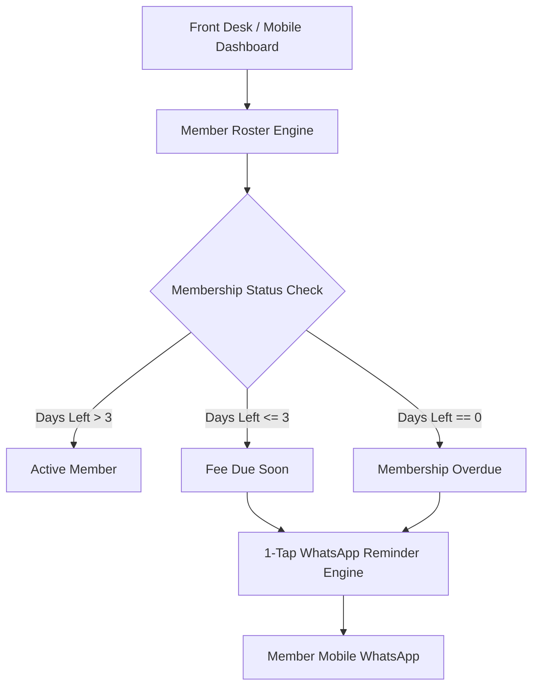

# RepCount — Mobile-First Gym CRM, Fee Tracker & WhatsApp Dues Engine

[](https://e-repcount-gym-payment-manager.vercel.app)
[](https://react.dev)
[](https://redux-toolkit.js.org/)
[](https://supabase.com)
**RepCount** is an intuitive, mobile-first member management workspace engineered specifically for gym owners, fitness studio operators, and sports academy managers. It replaces messy paper registers and chaotic spreadsheets with clear fee cycle tracking, automated renewal alerts, and direct WhatsApp payment reminders.

---

## Architecture Flow



---

## Core Features

- **Member Directory & Plan Tracking:** View active passes, plan types (Monthly, Quarterly, Annual, PT), and membership expiration dates at a glance.
- **Automated Fee Expiry Alerts:** Categorizes members into *Active*, *Due Soon (<= 3 days)*, and *Fee Overdue* automatically.
- **1-Tap WhatsApp Reminder Dispatch:** Generate personalized WhatsApp message links with one tap, reminding members about upcoming renewals without awkward phone calls.
- **Digital Payment Receipts:** Record Cash vs. UPI payments and generate digital receipts.
- **Staff-Friendly Interface:** Engineered mobile-first so gym floor trainers and front-desk receptionists can operate it with zero technical training.

---

## Tech Stack

- **Frontend:** React, Vite, Redux Toolkit, Tailwind CSS, Lucide Icons, Framer Motion
- **Database:** Supabase (PostgreSQL with membership schema and functions)
- **Deployment:** Vercel

---

## Local Development Setup

```bash
# 1. Clone repository
git clone https://github.com/MuhammadMinhaj229/e-repcount-gym-payment-manager.git
cd e-repcount-gym-payment-manager

# 2. Install dependencies
npm install

# 3. Setup environment variables
cp .env.example .env
```

Add your Supabase keys to `.env`:
```env
VITE_SUPABASE_URL=https://your-project.supabase.co
VITE_SUPABASE_ANON_KEY=your-anon-key
```

```bash
# 4. Run development server
npm run dev
```

---

## How to Deploy to Vercel

1. Push your repository to GitHub.
2. In the **Vercel Dashboard**, click **Import Project** and select `e-repcount-gym-payment-manager`.
3. Set the build parameters:
   - **Framework Preset:** Vite
   - **Build Command:** `npm run build`
   - **Output Directory:** `dist`
4. Set the environment variables (`VITE_SUPABASE_URL`, `VITE_SUPABASE_ANON_KEY`).
5. Click **Deploy**.

---

## License & Author
Engineered by **Mohammed Minhaj Mahmood** ([@MuhammadMinhaj229](https://github.com/MuhammadMinhaj229)).  
Branded and supported as *Powered by Alif Growth Media*.
